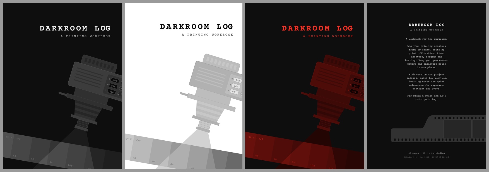

# Analog Workbook – Darkroom Log

-orange)


A printable workbook for darkroom printing: log your sessions frame by frame and print by print, keep your processes, papers and enlargers in one place, and have quick references for exposure, contrast and color at hand.

Made for black & white and RA-4 color printing, with color heads or filter/grade systems.



## What's inside

- **Session log:** two sessions per page, each with a pre-printed session number. Columns for print ID, filtration (C · M · Y or grade), time, aperture and dodge · burn · notes, plus a session notes field. Long sessions simply continue in the next block.
- **Setup tables:** processes (B/W and RA-4), enlargers & lenses, printing papers.
- **Indexes:** session index and project index.
- **Notes pages:** your own darkroom learnings.
- **Quick references:**
  - f-stop timing table
  - print size conversion
  - RA-4 color cast corrections
  - contrast grades on a color head
  - zone system
- **How-to (2 pages):** explains the workbook with example entries. A QR code links to the extended 2-page how-to (A4), which is also available separately.

## Variants

| | Ring binding | Booklet | Online / self-print |
|---|---|---|---|
| **Pages** | 80 + cover | 40 + cover | 40 + 2 cover pages (light, dark or red cover) |
| **A5** | ✓ | ✓ | ✓ |
| **A4** | ✓ (larger fields, extra columns) | ✓ | ✓ |
| **Bleed** | 3 mm | 3 mm | none |

Each variant comes as **PDF** (ready to print or upload to a print service) and **Word** (for small edits). Covers come in a dark, a light and a safelight-red theme.

Languages: English (German planned).

## Download

Ready-made files are attached to the [Releases](../../releases) of this repository.

## Printing

- **Print service:** use the print versions with 3 mm bleed. They were made for epubli's ring binding and booklet formats, but should work with any service that accepts PDF with bleed.
- **At home:** use the online / self-print version and print at **100 % (actual size)**, not "fit to page".
- **Under safelight:** all lines and labels are grey or black, so they stay visible under red or amber safelights.

## Building the files yourself

The workbook is generated by scripts, so every variant can be rebuilt or adapted.

### Covers

```
pip install -r requirements.txt
python3 src/covers/make_covers.py
```

You also need `rsvg-convert` (librsvg) and the fonts listed below. Details are in [`src/covers/README.md`](src/covers/README.md).

### Workbook interior

```
npm install
python3 src/workbook/build_all.py            # all variants
python3 src/workbook/build_all.py A5_ring    # only matching variants
python3 src/workbook/preview.py session      # PNG preview of single page types (A5 + A4)
```

You also need LibreOffice (`soffice`) for the PDF export, `pdfinfo`/`pdftoppm` (poppler) and the covers in `dist/covers` for the online versions. Output goes to `dist/workbook/`. Details are in [`src/workbook/README.md`](src/workbook/README.md).

### Fonts

Both fonts are under the SIL Open Font License. See [`fonts/README.md`](fonts/README.md).

- [Courier Prime](https://fonts.google.com/specimen/Courier+Prime): typewriter font for the layout
- [Caveat](https://fonts.google.com/specimen/Caveat): handwriting font for the example entries

## Repository structure

```
analog-workbook-darkroom-log/
├── README.md              this file
├── LICENSE                licensing overview (content vs. code)
├── LICENSES/              full license texts
├── CHANGELOG.md           editions and changes
├── requirements.txt       Python dependencies
├── package.json           Node.js dependencies (docx, sharp, qrcode)
├── assets/previews/       preview images for this README
├── fonts/                 font files (see fonts/README.md)
├── src/
│   ├── covers/            cover generator (Python, SVG → JPG)
│   └── workbook/          interior generator (Word/PDF)
└── dist/                  generated output (not tracked; published via Releases)
```

## Contributing

Corrections, ideas for fields or quick references, and translations are welcome. Please open an issue or a pull request.

## License

This repository uses two licenses:

- **Content:** texts, layout, page designs, cover designs and the generated PDF/Word/JPG files. Licensed under [CC BY-NC-SA 4.0](LICENSES/CC-BY-NC-SA-4.0.txt).
  Printing and handing out copies in workshops and courses is explicitly allowed, including as part of a paid course, as long as the workbook is not sold separately from the course or workshop.
- **Code:** all scripts in `src/`, licensed under [AGPL-3.0-or-later](LICENSES/AGPL-3.0-or-later.txt).

See [LICENSE](LICENSE) for details.

## Note on AI assistance

Parts of the scripts in this repository and parts of the documentation were created with the help of an AI model (Claude Opus 5.5 by Anthropic). Everything was reviewed by a human, but errors may still have been missed. Please treat the code, the generated files and the reference content with the usual caution: check values and results that matter to you, such as the quick-reference tables, before relying on them, and report anything that looks wrong as an issue.
